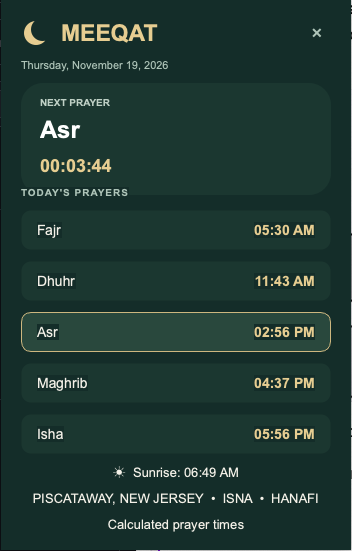

# 🌙 Meeqat

**A minimalist prayer-times widget for macOS.**

Meeqat is a lightweight desktop prayer-times application built with Python and PySide6. It displays daily prayer times, highlights the upcoming prayer, and features a live countdown—all within a clean, unobtrusive desktop widget.

## Features

- 🕌 Daily prayer times: Fajr, Dhuhr, Asr, Maghrib, and Isha
- ⏳ Live countdown to the next prayer
- ✨ Automatic highlighting of the upcoming prayer
- ☀️ Sunrise display
- 🌙 Floating desktop widget
- 📌 macOS menu bar integration
- 🎨 Minimal emerald-and-gold interface
- 🖥️ Standalone macOS application

## Screenshots



## Built With

- Python
- PySide6
- adhanpy

## Prayer Time Calculations

Meeqat currently uses:

- **Calculation method:** ISNA
- **Asr calculation:** Hanafi
- **Prayer time engine:** adhanpy

Prayer times are calculated locally using the configured location and calculation settings.

## Installation

### Download

_Standalone releases will be made available in the Releases section._

### Run from source

Clone the repository:

```bash
git clone git@github.com:YOUR-GITHUB-USERNAME/meeqat.git
cd meeqat
```

Create and activate a virtual environment:

```bash
python3 -m venv .venv
source .venv/bin/activate
```

Install the dependencies:

```bash
pip install -r requirements.txt
```

Run Meeqat:

```bash
python app.py
```

**Requirements**

macOS
Python 3

**Roadmap**

Planned improvements:Roadmap

- [ ] Configurable location
- [ ] Location search
- [ ] Multiple prayer calculation methods
- [ ] Standard and Hanafi Asr options
- [ ] Settings window
- [ ] Persistent user preferences
- [ ] Prayer notifications
- [ ] Customizable appearance

**Contributing**

Suggestions, bug reports, and contributions are welcome.

Meeqat is an evolving project, and improvements are being made incrementally.

**License**
License information will be added.
